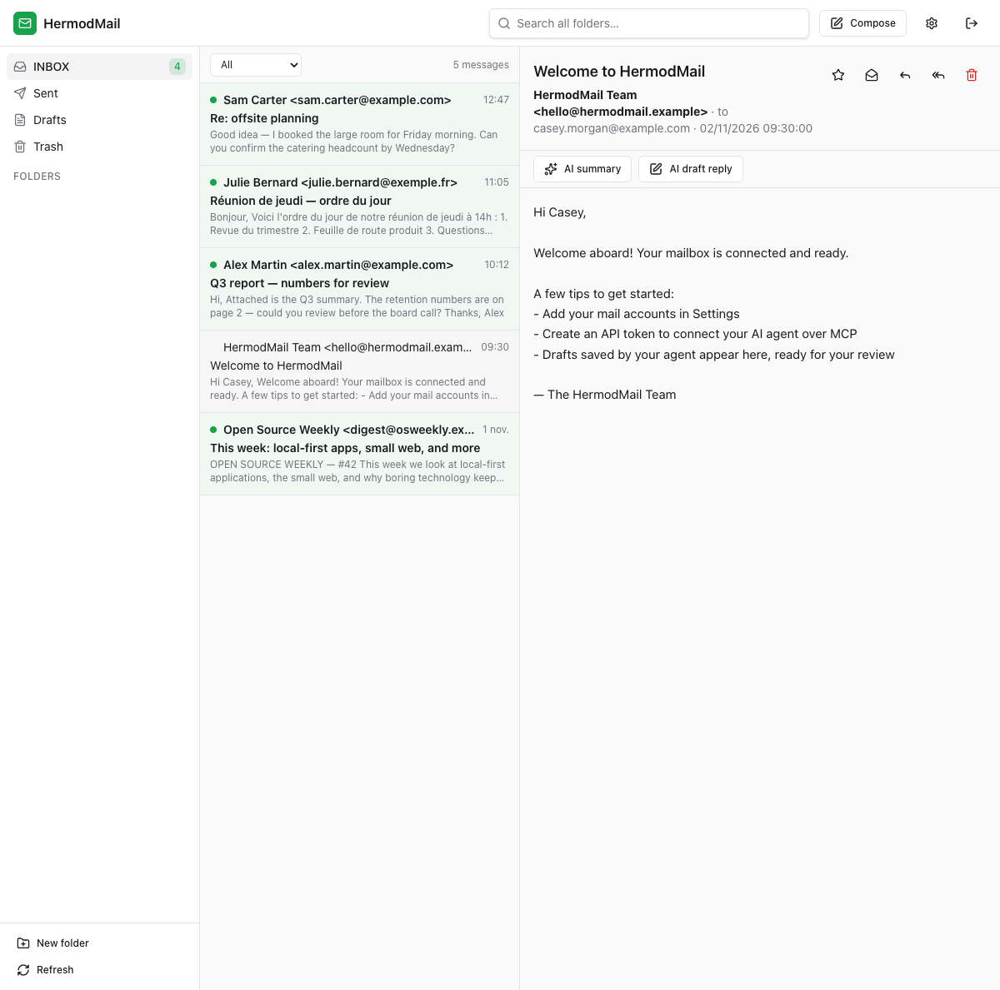
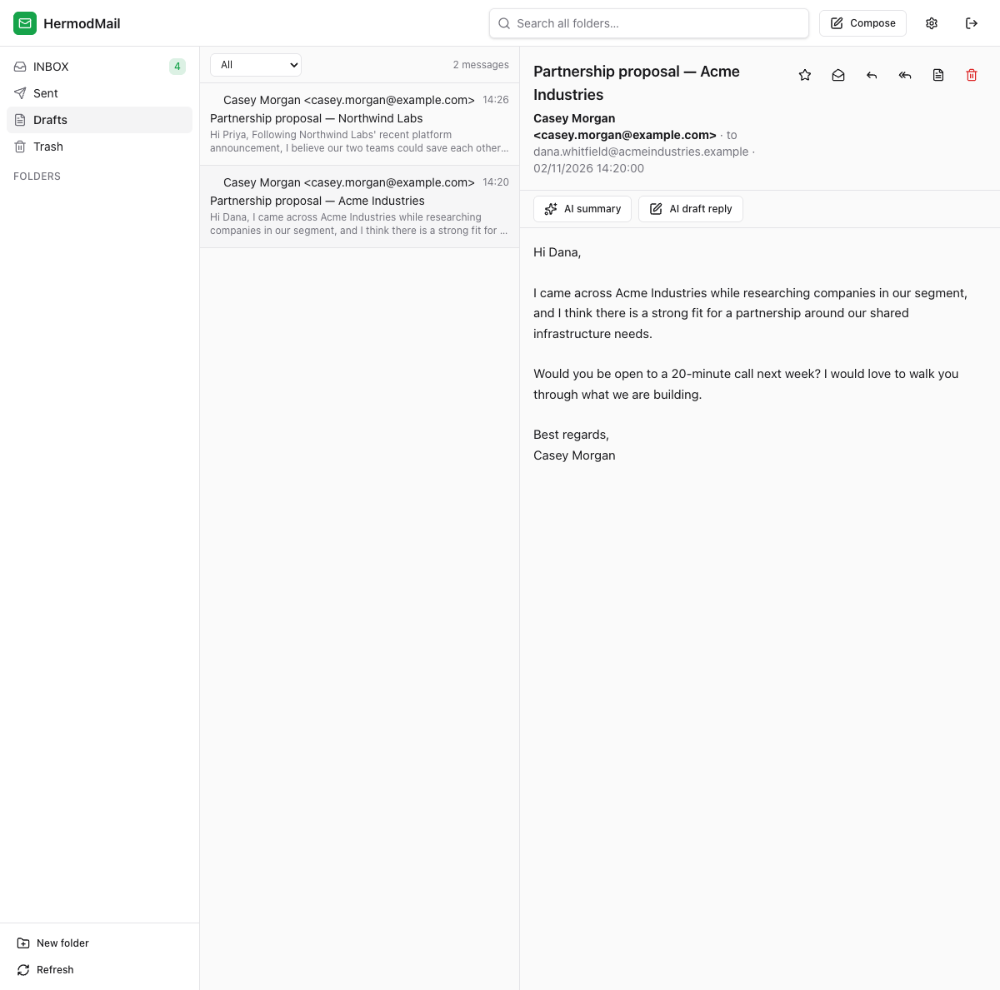
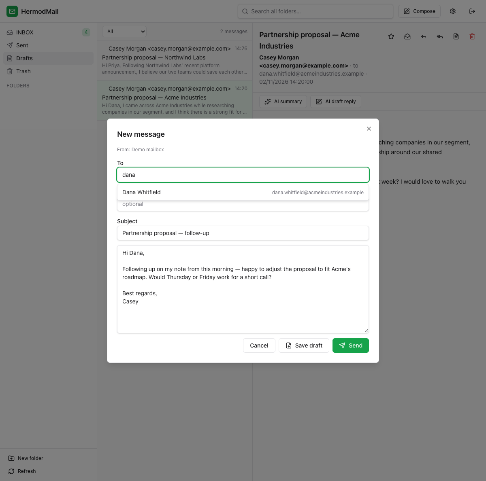
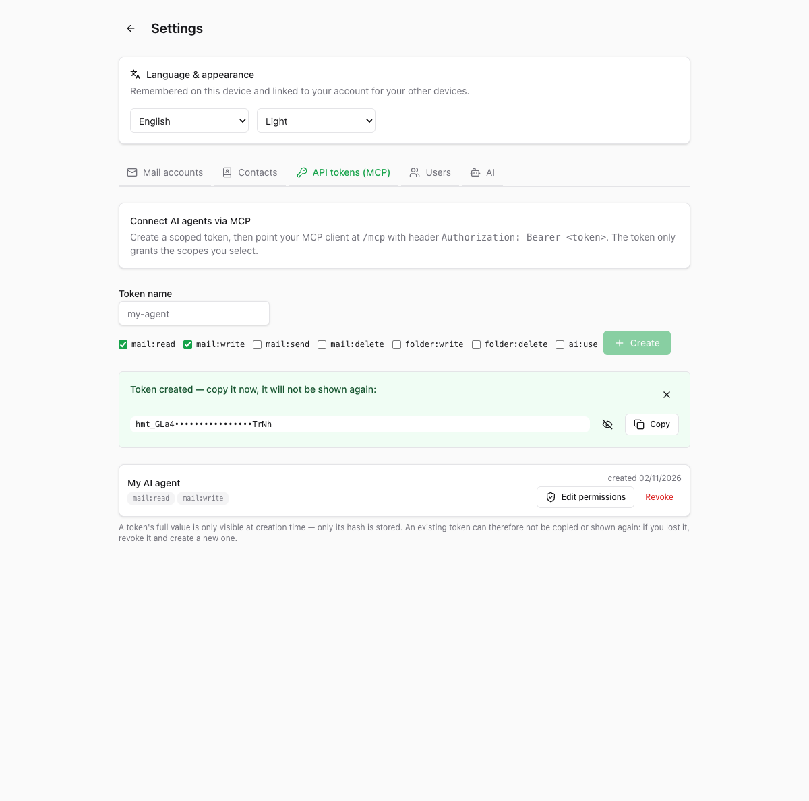
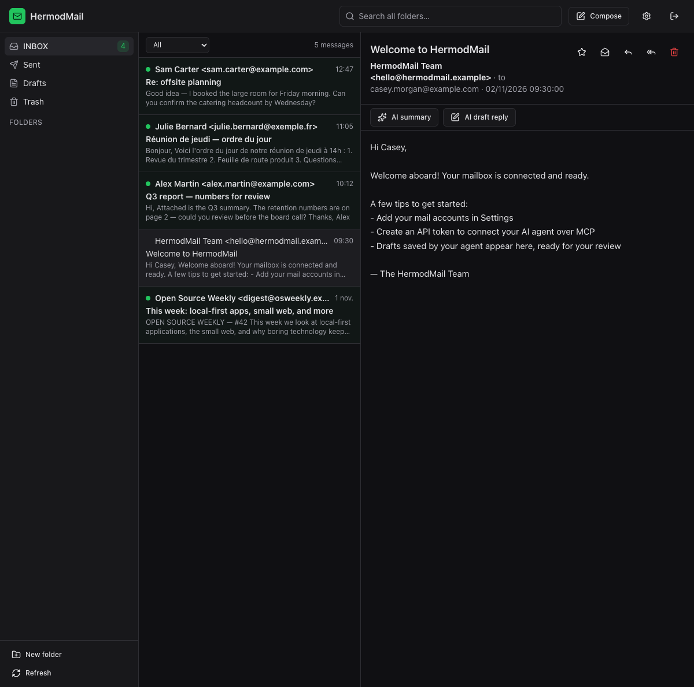

# HermodMail

[](https://github.com/cyril-belin/HermodMail/releases/tag/v0.1.0-beta.1)
[](#release-status--compatibility)
[](https://github.com/cyril-belin/HermodMail/actions/workflows/ci.yml)
[](LICENSE)

**A mailbox where humans and AI agents work together.**

📌 **Official website:** [cyril-belin.github.io/HermodMail](https://cyril-belin.github.io/HermodMail/)
(English and French — this README remains the complete technical reference.)
🏷️ **First public beta:** [v0.1.0-beta.1](https://github.com/cyril-belin/HermodMail/releases/tag/v0.1.0-beta.1)

HermodMail is an open-source webmail with a **native MCP server**: your existing
IMAP/SMTP mailbox, one shared business engine, and permission rules that apply
identically to the person reading mail in the browser and the agent working
through the API.

```
┌─────────────┐   HTTP/cookies   ┌──────────────────────────────────────────┐
│  Vue web UI │ ───────────────► │  Fastify API                             │
└─────────────┘                  │        │                                 │
┌─────────────┐   Bearer token   │        ▼                                 │
│ MCP agents  │ ───────────────► │  MailEngine (auth+scopes enforced here)  │
└─────────────┘                  │   ├── IMAP  (imapflow)   SQLite cache    │
                                 │   ├── SMTP  (nodemailer)  (better-       │
┌─────────────┐   OpenAI-compat  │   └── AI    (Ollama / any)  sqlite3)     │
│ Ollama etc. │ ◄─────────────── │                                          │
└─────────────┘                  └──────────────────────────────────────────┘
```

## Download & Install

**Latest public pre-release: [`v0.1.0-beta.1`](https://github.com/cyril-belin/HermodMail/releases/tag/v0.1.0-beta.1)**
(source archives are attached to the release; you are reading a beta — see
[Release status & compatibility](#release-status--compatibility)).

### Requirements

- Node.js **≥ 22** (CI runs on 22 and 24) and npm — no other tooling needed for
  a source install. Docker or Podman for the container route.

### Option A — Docker / Podman

```bash
git clone -b v0.1.0-beta.1 https://github.com/cyril-belin/HermodMail.git
cd HermodMail
printf 'HERMODMAIL_SECRET=%s\n' "$(openssl rand -base64 48)" > .env
docker compose up -d --build      # or: podman-compose up -d --build
```

Then open **http://localhost:8667** — the first visit asks you to create the
admin account. All data lives in the `hermodmail-data` volume. Behind a
reverse proxy or on a public host, also set `HERMODMAIL_COOKIE_SECURE=1` and
`TRUST_PROXY=1` (see [VPS section](#deploying-on-a-vps-https--remote-agents)).

### Option B — from source

```bash
git clone -b v0.1.0-beta.1 https://github.com/cyril-belin/HermodMail.git
cd HermodMail
npm ci
npm run build
export HERMODMAIL_SECRET="$(openssl rand -base64 48)"   # keep it stable across restarts
PORT=8667 HOST=0.0.0.0 HERMODMAIL_WEB_DIST=apps/web/dist node apps/server/dist/index.js
```

Open **http://localhost:8667**. To run HermodMail in the background across
reboots, wrap that last line in your favourite service manager (systemd,
launchd, `pm2`…).

### First steps

1. Open the webmail → create the **admin account** (first account = admin).
2. **Settings → Mail accounts** → add your IMAP/SMTP account (host, port,
   TLS mode, credentials). Use the *Test* button before syncing.
3. Browse, search (full-text), organize folders — everything works without AI.
4. Optional: **Settings → AI** → point HermodMail at any OpenAI-compatible API
   or a local Ollama for summaries, reply drafting and translation.
5. Optional: **Settings → API tokens (MCP)** → create a scoped token and point
   your agent at `http://<host>:8667/mcp` (details in
   [MCP usage for agents](#mcp-usage-for-agents)).

`HERMODMAIL_SECRET` is the master key that encrypts stored IMAP/SMTP
credentials. Generate it once, keep it stable, and back it up together with
the data directory — backups are not portable without it, and rotating it
without re-entering the mail passwords makes credentials undecryptable.

## Why HermodMail exists

For decades, email clients were designed for one kind of user: a human sitting
in front of a screen. That made sense — until it didn't. Today, AI agents can
read, prepare, organize and send messages. Yet connecting one to a real mailbox
usually means a pile of scripts, separate IMAP credentials with far too much
power, and authorization logic you have to reinvent for every project.

HermodMail started from a simple question: **why not give humans and agents one
common email environment, with a single business engine and controlled
permissions?**

The human uses a classic web interface. The agent uses a native MCP endpoint.
Both work on the same accounts and folders — but each with exactly the rights
that were granted to them. No parallel credential store, no out-of-band sync,
no "the agent has my full mailbox password" problem.

## How humans and agents collaborate

Every request — from the browser or from an agent — goes through **the same
engine**. Scopes and ownership are enforced there, never in the adapters. That
one design decision is what makes the collaboration safe:

- A **scoped API token** defines what an agent may do: read mail, write mail,
  send, delete, manage folders, use the AI assistant. Grant or revoke scopes
  at any time — a running agent session picks the change up immediately.
- Agents **never send on their own initiative unless you let them**. Their
  strongest default move is writing to the *real* IMAP Drafts folder — visible
  and editable in HermodMail and in every other mail client.
- Tokens cannot manage mail accounts at all. A leaked read-only token cannot
  enroll new credentials; adding a mailbox requires an interactive session.
- One HermodMail instance is **multi-user**: each person adds their own mail
  accounts and issues their own tokens, with isolation enforced in the engine.

## A concrete workflow

Imagine an entrepreneur on a train.

They ask their agent to find 50 prospects. The agent does its research, writes
50 personalized messages, and saves them through MCP — straight into the
**IMAP Drafts folder**. It sends nothing.

Later, the entrepreneur opens HermodMail, finds the 50 drafts waiting, reads
each one, edits what needs editing, and sends.

The agent did the work. The human kept the decision.

That is one illustration of HermodMail's philosophy — not its only use. Search,
summarize, triage, folder management, reply drafting: whatever your agent does,
it happens inside the same permissions model as the human.

## What makes it different

- **Native MCP, not a bolt-on.** `/mcp` is a route of the same server as the
  web UI, speaking full streamable HTTP (SSE responses to POST, a
  server-initiated stream per session, 15 s heartbeats). Seventeen tools:
  `list_accounts`, `list_folders`, `sync_folder`, `list_messages`,
  `search_messages`, `get_message`, `mark_message`, `move_message`,
  `delete_message`, `send_message`, `create_draft`, `summarize_message`,
  `draft_reply`, `export_markdown`, `create_folder`, `rename_folder`,
  `delete_folder`.
- **Granular permissions.** Tokens carry explicit scopes (`mail:read`,
  `mail:write`, `mail:send`, `mail:delete`, `folder:write`, `folder:delete`,
  `ai:use`) — editable at any time, effective immediately, stored as SHA-256
  hashes only.
- **Shared drafts, real ones.** `create_draft` appends a genuine IMAP draft
  (`\Draft` flag) to the server's Drafts folder. Nothing is ever sent by a
  draft save. The human reviews it in the UI — or in Thunderbird, or Gmail.
- **One engine, not two codepaths.** The web API and MCP share the same mail
  engine, so a fix or a guardrail applies to both at once.
- **Honest SMTP.** A failure after DATA transmission leaves the outcome
  *undetermined*: HermodMail classifies definitive rejections versus uncertain
  failures and never auto-retries a send. No duplicate bombs.
- **Guardrails on folders.** INBOX and system folders can't be renamed or
  deleted; deleting a non-empty folder requires an explicit `confirm` — an
  agent can never wipe mail in one shot.

## A complete webmail first

HermodMail is a fully usable webmail even with **zero AI configured**:

- Real IMAP/SMTP — connect any mailbox; folders, messages, flags, moves,
  sent-folder filing, Trash-aware deletion.
- Local SQLite cache (WAL) with FTS5 full-text search across subject, people
  and bodies.
- Safe HTML rendering — all email HTML sanitized server-side; attachment
  downloads controlled.
- Smart address book — correspondents harvested automatically from your mail
  (including existing IMAP history), powering recipient autocomplete; editable
  manually in Settings.
- Real IMAP folder management from the UI, with the same INBOX/system-folder
  protections as the agent API.
- Multilingual UI (French, English, Spanish) with on-demand message
  translation, dark theme, Markdown export of any message.
- Multi-user with admin-created accounts and strict per-user isolation.

## AI: optional and provider-agnostic

**HermodMail is not tied to any AI vendor.**

- The built-in assistant (message summaries, reply drafting, translation) is
  **entirely optional** — the webmail works without any AI provider configured.
- It talks to **any OpenAI-compatible API**, so you can pick among many cloud
  providers and models; **Ollama** gives you fully local, offline models.
- We used **Gemini through its OpenAI-compatible endpoint** during real-world
  testing — it's an example of the compatible family, not an integration
  HermodMail depends on. We don't claim every compatible provider has been
  individually tested.
- Agents connected over MCP bring **their own LLM**. What HermodMail's
  configured provider does is separate; the agent's intelligence never routes
  through HermodMail.
- No single provider is imposed — swap anytime in Settings.

Email content and headers sent to models are always fenced as untrusted data
(`<<<UNTRUSTED_EMAIL_CONTENT>>>`, control characters stripped) with an explicit
system rule to ignore instructions inside email content — a prompt-injection
guard, not a hope. And AI can never send mail by itself: only `send_message`
with the `mail:send` scope does.

## Screenshots

| The webmail | Drafts prepared by an agent |
| --- | --- |
|  |  |

| Composing (contact autocomplete, save draft) | API tokens for MCP agents |
| --- | --- |
|  |  |

_Dark mode:_



## Configuration (env)

| Variable | Default | Meaning |
| --- | --- | --- |
| `PORT` / `HOST` | `8667` / `127.0.0.1` | HTTP listen address |
| `HERMODMAIL_DATA_DIR` | `./data` | SQLite DB + secret key location |
| `HERMODMAIL_SECRET` | auto-generated file | Master key for credential encryption (≥ 32 chars). **Set it in production** or backups are not portable. |
| `HERMODMAIL_WEB_DIST` | – | Built web client to serve |
| `HERMODMAIL_COOKIE_SECURE` | off | Set `Secure` on session cookies — enable **only** behind HTTPS |
| `TRUST_PROXY` | off | Set `1` behind a reverse proxy so rate limiting uses the real client IP |
| `SESSION_TTL_HOURS` | `336` (14 d) | Web session lifetime |
| `INITIAL_SYNC_LIMIT` | `200` | Messages fetched on first folder sync |
| `BODY_INDEX_LIMIT` | `300` | Recent messages body-indexed for search |
| `MAX_ATTACHMENT_SIZE` | `5242880` | Largest attachment cached (bytes) |
| `LOG_LEVEL` | `info` | Fastify log level |

## MCP usage for agents

1. In HermodMail: **Settings → API tokens (MCP)** → create a token with only
   the scopes the agent needs.
2. Point any MCP client at the streamable-HTTP endpoint:

```json
{
  "mcpServers": {
    "hermodmail": {
      "type": "http",
      "url": "http://localhost:8667/mcp",
      "headers": { "Authorization": "Bearer hmt_..." }
    }
  }
}
```

`create_folder` / `rename_folder` (scope `folder:write`) and `delete_folder`
(scope `folder:delete`) operate on the **real IMAP server**, with the folder
guardrails described above. `create_draft` saves a **real IMAP draft** —
recipients, subject, body and optional conversation references
(`in_reply_to` / `references`) — without ever sending anything; `draft_reply`
is different: it only returns an AI text proposal. Drafts saved by agents are
visible and editable in the web UI (Drafts folder → "edit draft") and in any
other mail client.

Every call runs through the same engine as the UI: the agent sees only the
token owner's accounts, and destructive/sending tools fail without the
corresponding scope.

Wherever HermodMail runs, MCP lives at `http://<host>:8667/mcp`.

## Deploying on a VPS (HTTPS + remote agents)

| | Local machine | VPS |
| --- | --- | --- |
| Web UI | `http://localhost:8667/` | `https://mail.example.com/` |
| MCP | `http://localhost:8667/mcp` | `https://mail.example.com/mcp` |
| Agent auth | `Bearer hmt_…` | identical |

### 1. Run the container

```bash
git clone <repo> && cd HermodMail
echo "HERMODMAIL_SECRET=$(openssl rand -base64 48)" > .env
docker compose up -d --build
```

`HERMODMAIL_SECRET` is the key that encrypts stored IMAP/SMTP credentials —
back it up and never rotate it casually (rotating without re-entering the mail
passwords makes them undecryptable).

### 2. Put TLS in front (strongly recommended)

Over plain HTTP, agent tokens and session cookies travel unencrypted. The
simplest front is Caddy with automatic certificates:

```
# Caddyfile
mail.example.com {
    reverse_proxy 127.0.0.1:8667
}
```

Then keep the app port private and tell it it lives behind a proxy — in
`docker-compose.yml`:

```yaml
    ports:
      - "127.0.0.1:8667:8667"   # only the proxy reaches the app
    environment:
      - HERMODMAIL_SECRET=${HERMODMAIL_SECRET}
      - HERMODMAIL_COOKIE_SECURE=1   # cookies over HTTPS only
      - TRUST_PROXY=1                # rate-limit on the real client IP
```

SSE responses carry `X-Accel-Buffering: no` and comment heartbeats every 15 s
so reverse proxies don't buffer or drop idle MCP streams.

### 3. Multi-user on one VPS

The first account created becomes admin; every user then adds **their own**
mail accounts and creates **their own** MCP tokens. Isolation is enforced in
the engine and verified end to end: an agent holding user A's token sees only
A's mailboxes, and a read-only token cannot send.

## Security model

- Passwords: scrypt. Sessions: hashed tokens, HttpOnly SameSite cookie.
  Agents: hashed Bearer tokens with explicit scopes, editable and revocable at
  any time (effective immediately, including inside an open MCP session).
- Mail credentials: AES-256-GCM, key = HMAC-derived subkey of
  `HERMODMAIL_SECRET`. Secrets never leave the server except to the mail
  provider itself.
- Email HTML is sanitized server-side before storage (defense in depth; the
  client never renders raw email HTML). Attachment filenames are re-sanitized
  before being echoed into HTTP headers.
- CSP on the web client, `no-store` on API responses, same-origin enforcement
  on cookie-authenticated mutations (login CSRF included), login rate-limiting,
  MCP sessions bound to their token's owner.
- **SMTP honesty** and **prompt-injection fencing** as described above.

## Testing

- **200 automated tests** (server + web): crypto, auth, sanitization, mail
  engine, contacts & drafts with real MIME parsing/sending, AI guardrails,
  MCP over HTTP (streamable, SSE), folder protections, reliability/chaos
  (killed IMAP connections, SMTP failures, concurrent syncs), property-based
  checks, static web-client serving, and a real local IMAP/SMTP fixture server.
- **Dependency audits**: `npm audit` and `npm audit --omit=dev` report
  **zero known vulnerabilities**; both audits run in CI on every pull request
  (Node 22 and 24).
- **Beyond the suite**, we have run real IMAP/SMTP sessions against a live
  LWS-hosted mailbox, exercised end to end from an MCP agent — folder cycles,
  draft saving, real SMTP sending.

## Development

```bash
npm install
npm run dev          # API on :8667
npm run dev:web      # Vite dev server on :5667 (proxies /api and /mcp)

npm run typecheck    # server + web strict TypeScript
npm test             # 200 vitest tests
```

Open http://localhost:5667 — the first visit asks you to create the admin
account, then add your IMAP/SMTP account in Settings.

## Release status & compatibility

**Status: public beta (`v0.1.0-beta.1`).** HermodMail works today and is
actively developed. This is a beta, not a finished 1.0: expect rough edges,
and **breaking changes (API, database schema, configuration) remain possible
before 1.0** — they will be called out in release notes.

- **Node.js**: ≥ 22 required (CI verifies 22 and 24).
- **Tested install paths**:
  - Source install — exercised end to end from a clean source archive:
    `npm ci` → build → serve → admin setup → login → data survives a restart
    (macOS arm64 locally; Ubuntu on CI).
  - Docker/Podman — `Dockerfile` (multi-stage, non-root, healthcheck) and
    `docker-compose.yml` are provided and reviewed; the container build is
    **not yet exercised by CI**. Reports from container users are welcome in
    [Issues](https://github.com/cyril-belin/HermodMail/issues).
- **Backups**: back up the data directory (`hermodmail.sqlite` + WAL files)
  **and** `HERMODMAIL_SECRET` together. SQLite migrations run automatically at
  startup and are forward-only.
- **Updating**: fetch the new tag, `npm ci && npm run build`, restart with the
  same `HERMODMAIL_SECRET` and data directory. Do not rotate the secret
  casually (see [Download & Install](#download--install)).
- **Bugs and feedback**: [GitHub Issues](https://github.com/cyril-belin/HermodMail/issues).

Layout: `apps/server/src/core` (engine: auth, mail, ai, contacts — no transport
knowledge), `apps/server/src/http` (thin REST adapter), `apps/server/src/mcp`
(thin MCP adapter), `apps/web` (Vue 3 + Tailwind 4 + reka-ui components).

The engine talks to mail servers only through the `MailTransport`/`SmtpSender`
interfaces — production uses imapflow/nodemailer; tests use an in-memory
transport with real MIME parsing.

## Roadmap

- IMAP IDLE push notifications · sieve-like rules · calendar attachments ·
  multi-select batch actions · per-folder AI auto-classification · CardDAV
  contacts.

## Website

The official product site lives in [`site/`](site/) — a static
[Astro](https://astro.build) project, fully isolated from the app workspaces
(this monorepo's `npm` scripts never touch it). It is published automatically
to <https://cyril-belin.github.io/HermodMail/> by
[`.github/workflows/deploy-site.yml`](.github/workflows/deploy-site.yml) when
files under `site/` change on `main` (manual runs are also available from the
Actions tab). English is the default language; the French version lives under
`/fr/`.

To work on the site locally:

```bash
cd site
npm install
npm run dev       # dev server (URL printed in the terminal)
npm run build     # static output in site/dist/ (what Pages publishes)
```

Screenshots shown on the site come from `docs/screenshots/` — replace them
there and copy into `site/src/assets/` to refresh the site. No backend, no
secrets, and no mail infrastructure are involved in serving the site.

## License

HermodMail is licensed under the **GNU Affero General Public License v3.0 or
later** — see [LICENSE](LICENSE).
